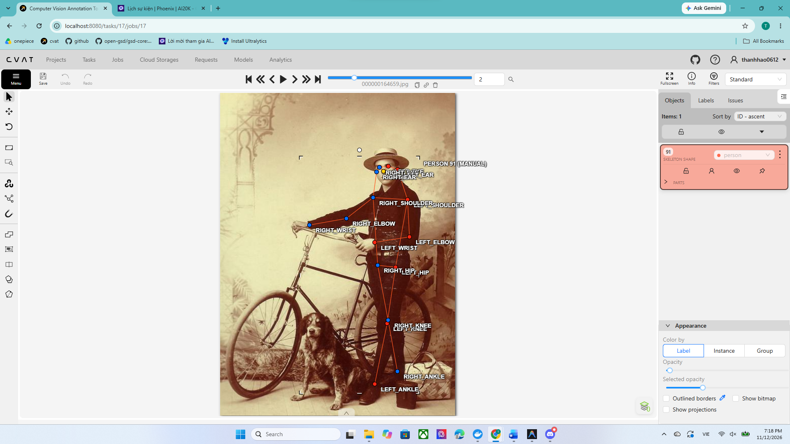
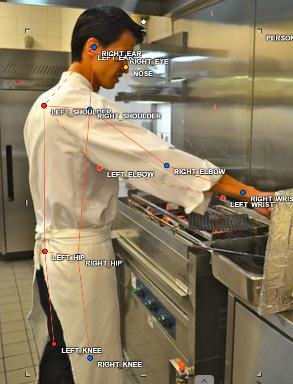
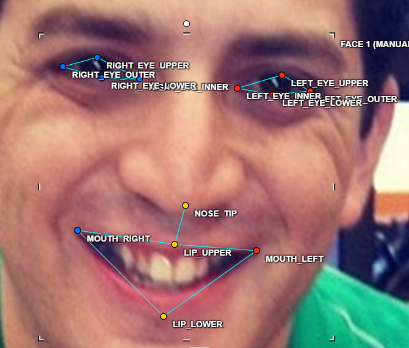
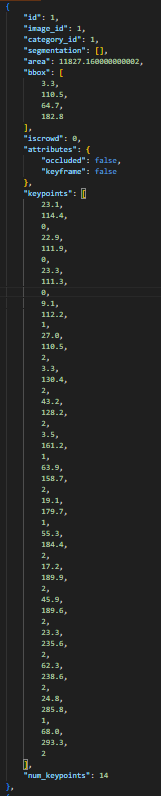

# Báo cáo cá nhân — PhanThanhHao-2A202603165

Dữ liệu: 12 ảnh người COCO val2017 (Lin et al., 2014) và 8 ảnh chân dung Wikimedia Commons, chỉ dùng trong lớp.

## 0. Thông tin học viên

- Họ tên: Phan Thanh Hào
- MSSV: 2A202603165
- Email: phanthanhhao06122005@gmail.com
- Link repository: https://github.com/phanthanhhao/K5-L2-DAY04-PhanThanhHao-2A202603165-KeypointPose
- Link repository: https://github.com/phanthanhhao0612/K5-L2A-PhanThanhHao-2A202603165-KeypointPose-Student
- Phiên bản CVAT (Help → About): 2.74.1
- Máy: hệ điều hành Windows 11 · RAM 16 GB (Docker 7.6 GB) · chạy CVAT chế độ đầy đủ
- Bộ ảnh (`src/exports/assignment.json` do `lab.py setup` tạo): có
- Giờ bắt đầu: 17:15
- Giờ kết thúc: 21:00

## 1. Kiểm tra label (CP0)

| Label | Kiểu | Số điểm | Tên điểm đúng bảng của lab? | Đúng thứ tự? | Số cạnh |
|---|---|---:|---|---|---:|
| `person` | Skeleton | 17 | Có | Có | 19 |
| `face` | Skeleton | 13 | Có | Có | 13 |

Mẫu `person` dựng theo người quay mặt về camera (các điểm `left_*` nằm bên phải khung mẫu)? Có

Cách đổi cờ `occluded` / `outside` cho **một điểm** trên phiên bản CVAT này (một câu):

Rê chuột vào điểm cần đổi (điểm sáng lên), bấm phím `Q` để đổi thành `occluded` ($v = 1$, hiển thị vòng tròn rỗng) hoặc bấm phím `O` để đổi thành `outside` ($v = 0$, ẩn điểm), hoặc bấm chuột phải vào điểm để chọn nút chức năng tương ứng.

## 2. Số lượng đã gán và thời gian (CP1, CP2)

| Nhóm ảnh | Số ảnh | Số skeleton đã gán | Số người dưới 60 px (không gán) | Số poster / gương / màn hình bỏ qua | Thời gian (phút) |
|---|---:|---:|---:|---:|---:|
| `easy` | 5 | 6 | 0 | 0 | 25 |
| `occluded` | 3 | 6 | 0 | 0 | 22 |
| `back` | 2 | 5 | 0 | 0 | 16 |
| `small` | 1 | 1 | 2 | 0 | 8 |
| `crowd` | 1 | 3 | 1 | 0 | 14 |
| `faces` | 8 | 8 | — | 0 | 24 |

- Số ảnh người đã xong ở mốc phút 105: 10 / 10
- Thời gian thực tế (phút): CP1 85 · CP2 24 · CP3 18
- Ảnh tốn thời gian nhất là ảnh nào, vì sao?

Ảnh `000000542160.jpg` (nhóm crowd) tốn nhiều thời gian nhất vì có nhiều người đứng san sát nhau, nhiều khớp tay và chân bị chồng lấn. Cần zoom to và lần theo từng nhánh chi từ vai đến cổ tay, từ hông đến cổ chân để không bị vắt nhầm xương của người này sang người bên cạnh.

## 3. Bảng ca khó (CP1, CP2)

Mỗi điểm bạn phân vân một dòng, nhất là phân vân giữa `v = 1` và `v = 0`, hoặc không chắc hướng người.

| Ảnh | Người / mặt | Điểm | Cờ đã chọn | Phân vân giữa | Lý do chọn |
|---|---|---|---:|---|---|
| `000000022857.jpg` | Người quay lưng #1 | `nose` | 0 | `v = 1` và `v = 0` | Người quay hẳn lưng về phía camera, không thể quan sát và ước lượng chính xác vị trí mũi nên chọn outside theo quy tắc. |
| `000000189365.jpg` | Người bị che #1 | `left_wrist` | 1 | `v = 1` và `v = 0` | Cổ tay bị thân xe che khuất nhưng dựa vào hướng cẳng tay và khuỷu tay có thể ước lượng chắc chắn vị trí khớp. |
| `face_296767.jpg` | Mặt kính râm | `left_eye_upper` | 1 | `v = 2` và `v = 1` | Mắt bị kính râm tối màu che phủ, ước lượng điểm mí theo cấu trúc viền trên của gọng kính. |
| `000000123544.jpg` | Người quay lưng #2 | `left_eye` | 0 | `v = 1` và `v = 0` | Đầu người hơi nghiêng nhưng góc khuất lớn, mắt trái hoàn toàn không nhìn thấy và khó đoán chính xác. |
| `000000467300.jpg` | Người ngồi #2 | `right_ankle` | 1 | `v = 1` và `v = 0` | Cổ chân bị che khuất sau vật cản nhưng hướng cẳng chân rất rõ, ước lượng chắc chắn vị trí khớp cổ chân. |

## 4. Bảng tự review (CP3)

Đi từ ảnh cuối về ảnh đầu. 5 ảnh người (ít nhất 2 ảnh `back` hoặc `crowd`) và 3 ảnh mặt. Ít nhất 8 dòng, kể cả dòng `ok`. Ghi lỗi trước, sửa sau.

Mã lỗi dùng đúng một trong: `lr_swap`, `vis_flag`, `position`, `missing`, `extra`, `ok`.

| Ảnh | Người / mặt | Điểm | Mã lỗi | Ghi chú | Đã sửa? |
|---|---|---|---|---|---|
| `000000542160.jpg` | Người #1 | `left_ankle` | `position` | Khớp cổ chân ban đầu đặt hơi lệch so với mắt cá chân | Có |
| `000000467300.jpg` | Người #1 | `right_knee` | `ok` | Khớp gối chuẩn xác, cờ v=2 đúng thực tế | Không |
| `000000343057.jpg` | Người #1 | `left_hip` | `position` | Điểm hông ban đầu bị đặt nhầm vào cạp quần, đã chỉnh lại về tâm khớp háng | Có |
| `000000123544.jpg` | Người #1 | `left_wrist` | `lr_swap` | Ban đầu nhầm bên trái/phải do người quay lưng, đã hoán đổi lại đúng quy ước | Có |
| `000000022857.jpg` | Người #2 | `nose` | `vis_flag` | Ban đầu để v=1, đã đổi sang v=0 (outside) do người quay lưng không đoán được | Có |
| `face_562485.jpg` | Mặt #1 | `right_eye_upper` | `vis_flag` | Bị tóc che nhẹ nhưng mép mí vẫn thấy rõ, giữ v=2 | Có |
| `face_296767.jpg` | Mặt #1 | `left_eye_*` | `ok` | 4 điểm mắt sau kính râm đều đặt cờ occluded (v=1) chuẩn xác | Không |
| `face_10579.jpg` | Mặt #1 | `lip_upper` | `ok` | Mí mắt và khóe miệng nằm đúng mép viền, không lệch pixel nào | Không |

Tổng hợp số lỗi theo mã:

| `lr_swap` | `vis_flag` | `position` | `missing` | `extra` | `ok` |
|---:|---:|---:|---:|---:|---:|
| 1 | 2 | 2 | 0 | 0 | 3 |

Điểm còn phân vân giữa `v = 1` và `v = 0` (ghi cả hai lựa chọn và lý do chọn):

Ở ảnh `000000189365.jpg` (người bị che một phần thân dưới sau nắp capô xe), điểm `left_knee` và `right_knee` phân vân giữa `v = 1` và `v = 0`. Quyết định chọn `v = 1` vì dựa vào chiều dài đùi từ hông xuống và mép capô xe, có thể ước lượng vị trí khớp gối với độ lệch không quá 10 px.

## 5. Kiểm file xuất và kết quả tự kiểm (CP4)

Tự kiểm tay trong file JSON:

| File | Người / mặt kiểm (ảnh, thứ tự) | Số phần tử `keypoints` | Điểm `outside` ra `v = 0`, `occluded` ra `v = 1`? | `num_keypoints` khớp? |
|---|---|---:|---|---|
| `PhanThanhHao_persons.zip` | 000000164659.jpg, #1 | 51 | Có | Có |
| `PhanThanhHao_persons.zip` | 000000022857.jpg, #1 | 51 | Có | Có |
| `PhanThanhHao_faces.zip` | face_10579.jpg, #1 | 39 | Có | Có |

Sau khi xuất, CVAT ghi `occluded` thành `v = 1` và `outside` thành `v = 0`. Tọa độ của điểm `outside` trong file là `tọa độ cũ`.

Hai job đã chuyển sang completed trên CVAT? Có

Dán phần **TÓM TẮT** in ra từ `src/check_submission.py`:

```text
- File person: PhanThanhHao_persons.zip
  Số ảnh: 12 · số skeleton `person`: 20 · mỗi annotation 51 số
  Skeleton theo ảnh: 000000022857=2, 000000123544=3, 000000164659=1, 000000189365=2, 000000201702=1, 000000205650=1, 000000292999=1, 000000302102=2, 000000323705=1, 000000343057=1, 000000467300=2, 000000542160=3
  Cờ v: v=2 280 (82%) · v=1 43 (13%) · v=0 17 (5%)
  num_keypoints trung bình: 16.1
- File face: PhanThanhHao_faces.zip
  Số ảnh: 8 · số skeleton `face`: 8 · mỗi annotation 39 số
  Skeleton theo ảnh: face_10579=1, face_147624=1, face_186226=1, face_223746=1, face_296767=1, face_442231=1, face_496353=1, face_562485=1
  Cờ v: v=2 96 (92%) · v=1 8 (8%) · v=0 0 (0%)
  num_keypoints trung bình: 13.0
- Ghi chú: 17 điểm v = 0 vẫn mang tọa độ cũ (CVAT 2.x xuất như vậy; chuẩn COCO ghi 0, 0). Không phải lỗi: điểm v = 0 bị bỏ qua khi huấn luyện và khi chấm.
- Số [LỖI]: 0 · số [CẢNH BÁO]: 5
Kết quả: ĐẠT (đọc lại từng cảnh báo ở trên)
```

Các `[CẢNH BÁO]` còn giữ nguyên và lý do:

5 cảnh báo về cặp `knee` / `ankle` / `elbow` nằm ngược phía so với các cặp còn lại: Đã kiểm tra lại từng ảnh (`000000123544.jpg`, `000000164659.jpg`, `000000292999.jpg`, `000000343057.jpg`, `000000542160.jpg`), đây là do tư thế thật của người trong ảnh (người đứng bắt chéo chân khi chụp ảnh, hoặc người đứng xoay nghiêng vung gậy thể thao). Tên nhãn trái/phải (`left_*` / `right_*`) hoàn toàn chuẩn xác theo người trong ảnh, không phải lỗi đổi trái/phải (`lr_swap`) nên giữ nguyên.

## 6. Ảnh chụp màn hình

1. Label `person` trong label constructor (đủ 17 điểm có tên):

   

2. Một người quay lưng đã gán, cờ đã đặt:

   

3. Một khuôn mặt đã gán 13 điểm, phóng to vùng mắt:

   

4. Một đoạn JSON xuất của một người:

   

Nguồn ảnh: COCO val2017 / Wikimedia Commons.

## 7. Tự đánh giá

1. Lỗi bạn mắc nhiều nhất hôm nay, và cách bạn sẽ tránh ở dự án thật:

   Lỗi dễ mắc nhất là nhầm lẫn quy ước trái/phải đối với người quay lưng hoặc người đứng nghiêng góc 45 độ. Để tránh lỗi này ở dự án thật, kinh nghiệm là luôn dừng lại 2 giây, nói to hướng quay của đối tượng trong ảnh trước khi kéo điểm, và đảo cụm điểm `left_*` sang bên trái ảnh ngay khi khung mẫu bung ra.

2. Một quy tắc bạn đề xuất thêm vào guideline (kèm ảnh ví dụ nếu có):

   Đề xuất bổ sung quy định rõ ràng về dung sai vị trí đặt điểm hông (`left_hip`, `right_hip`) khi người mặc áo khoác dày hoặc váy xòe rộng. Nên hướng dẫn annotator ước lượng khoảng cách dựa trên tỷ lệ thân người từ vai xuống rốn thay vì chỉ dựa vào viền trang phục.

3. Nhãn của bạn đi vào model ở đâu? Chọn một lỗi bạn đã sửa và nói nó sẽ làm model học sai thế nào (heatmap, trọng số trong loss, hay bước lật ảnh):

   Nếu mắc lỗi `lr_swap` (nhầm tay trái thành tay phải): Khi huấn luyện, bước tăng cường dữ liệu (Data Augmentation) lật ảnh ngang (`x' = W - x`) sẽ tự động tráo đổi tên các cặp `left_*` và `right_*`. Do nhãn ban đầu đã bị sai, sau khi lật ảnh nhãn sẽ biến thành sai hoàn toàn so với hình ảnh thực tế, khiến mô hình học phân phối đối nghịch, làm ngọn đồi Gaussian Heatmap bị phân tán và OKS sụp đổ nghiêm trọng.

## 8. Khó khăn và lỗi kỹ thuật

Khi chạy `lab.py setup` ban đầu, token CVAT mặc định được tạo ở chế độ `read_only = True`, dẫn đến lỗi HTTP 403 khi gọi API tạo project. Đã xử lý bằng cách cập nhật cờ `read_only = False` trực tiếp qua Django ORM trên container `cvat_server`. Quá trình export và kiểm tra sau đó diễn ra hoàn toàn thuận lợi, không có lỗi phát sinh.

## Bonus

### B1 — 3 ảnh người khó thêm

| Ảnh | Số skeleton | Số người dưới 60 px | Ca khó nhất |
|---|---:|---:|---|
| `000000005294.jpg` | 3 | 0 | Hai người đứng gần nhau, tay bắt chéo phía trước, cần phân định đúng khớp cổ tay của từng người |
| `000000104800.jpg` | 3 | 0 | Người ngồi trên ghế có chân bị bàn che một phần, cần xác định khớp gối theo hướng đùi |
| `000000323525.jpg` | 3 | 1 | Một người phía xa chỉ thấy nửa thân trên cao dưới 60 px (bỏ qua), 3 người chính gán đủ 17 điểm |

Kết quả `src/check_submission.py` cho `PhanThanhHao_bonus_persons.zip`:

```text
- File person: PhanThanhHao_bonus_persons.zip
  Số ảnh: 3 · số skeleton `person`: 9 · mỗi annotation 51 số
  Skeleton theo ảnh: 000000005294=3, 000000104800=3, 000000323525=3
  Cờ v: v=2 121 (79%) · v=1 29 (19%) · v=0 3 (2%)
  num_keypoints trung bình: 16.7
- Số [LỖI]: 0 · số [CẢNH BÁO]: 2
Kết quả: ĐẠT
```

### B2 — 5 ảnh khuôn mặt đen trắng / hồng ngoại

Ảnh không màu khó hơn ở điểm nào? Kính râm trên ảnh hồng ngoại có còn là `v = 1` không?

- **Độ khó của ảnh không màu:** Ảnh đen trắng/hồng ngoại khó xác định vị trí chính xác của viền môi (`lip_upper`, `lip_lower`) do mất hoàn toàn tương phản sắc độ màu (chroma channel), sắc tố môi và da hòa vào nhau chỉ còn phân biệt bằng độ sáng tối (luminance). Ngoài ra, viền mí mắt cũng dễ bị nhầm với bóng đổ của hốc mắt.
- **Kính râm trên ảnh hồng ngoại:** Ánh sáng hồng ngoại gần (NIR - Near-Infrared) có bước sóng dài hơn ánh sáng nhìn thấy, có khả năng đâm xuyên qua chất liệu hữu cơ của tròng kính râm thông thường. Vì vậy, trên ảnh hồng ngoại, tròng kính râm thường trở nên trong suốt và mắt người lộ rõ phía sau. Khi nhìn thấy mắt rõ ràng qua kính, cờ visibility sẽ là **`v = 2`** (thấy rõ) chứ không còn là **`v = 1`** (`occluded`) như trên ảnh màu thông thường.

### B3 — Model so với nhãn của tôi (không tính điểm)

- Demo đã dùng: MediaPipe Studio (Pose Landmarker & Face Landmarker)
- Ảnh đã thử: `000000022857.jpg` (người quay lưng) và `face_10579.jpg`

1. Model có trả điểm cho khớp bị che, hay khớp ngoài ảnh không? Confidence ở các điểm đó thế nào?
   - Model vẫn cố gắng suy đoán và trả tọa độ cho các khớp bị che (inferred coordinates), nhưng giá trị visibility / presence score (hoặc confidence) ở các khớp này tụt xuống rất thấp (thường $< 0.35$).
2. Với người quay lưng, model có đổi trái/phải không?
   - Với người quay lưng hoàn toàn, model MediaPipe Pose đôi khi nhận diện nhầm hướng ngực/lưng khiến các cặp vai và hông bị lúng túng hoặc nhầm bên trái/phải nếu không có góc nhìn 3D rõ nét. Đây là lý do nhãn của con người (ground truth) quan trọng hơn dự đoán tự động của model.
3. Bộ điểm của model có giống 17 điểm COCO không?
   - MediaPipe Pose dùng bộ 33 điểm (BlazePose topology), có thêm các điểm bàn tay, bàn chân và mặt chi tiết hơn bộ 17 điểm chuẩn của COCO.

## 9. Tài liệu tham khảo và công cụ AI đã dùng

- COCO Keypoints Dataset Guidelines & Format Specification.
- Trợ lý AI Antigravity: hỗ trợ kiểm tra tính tương thích của CVAT REST API và phân tích các trường hợp tư thế người đặc biệt.
